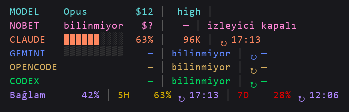

# AfuClaudePlugin

**English** | [Türkçe](#türkçe)

Two Claude Code skills and a settings tool, packaged so they can be dropped into any machine:

| Part | What it gives you |
|---|---|
| **telegram-mod** | A two-way Telegram loop — run Claude Code from your phone. It asks its questions in Telegram and reads your answers from there. |
| **afu-ai** | A CLI bridge — Claude routes a task to whichever CLI model fits (omp/Gemini, opencode, codex), verifies the result, and hands back one answer. |
| **router** | Agent router hook — type `ajan codex` / `ajan gemini` / `ajan opencode` / `ajan claude` and every following prompt goes to that agent; on a quota error it falls over to the next one. See [router/README.md](router/README.md). |
| **bypass_ayar** | Bypass permissions mode on/off — one command so Claude Code stops asking permission for every tool. See [Bypass permissions mode](#bypass-permissions-mode). |

**No credentials in this repo.** Tokens and chat ids come from a gitignored `.env`;
each CLI subagent uses its own login, so nothing is ever hardcoded.

## Quick install (Claude Code and Codex)

> **Give this to your Claude/Codex:** paste the link to [KURULUM_CLAUDE.md](KURULUM_CLAUDE.md) and say "install this" — it contains step-by-step agent instructions (asks what you have, installs, verifies, tells you which steps need you).

One command copies all skills to `~/.claude/skills` (Claude Code) and `~/.agents/skills` (Codex):

```powershell
git clone https://github.com/pirncedark/AfuClaudePlugin.git; cd AfuClaudePlugin; .\install.ps1          # or: .\install.ps1 -Target codex
```
```bash
git clone https://github.com/pirncedark/AfuClaudePlugin.git && cd AfuClaudePlugin && ./install.sh        # or: ./install.sh codex
```

Skills included: `isci-terminal`, `afu-ai`, `ajan-kopru`, `zaman-asimi-zinciri`, `isaretle-devret`, `kendin-yap`, `ana-terminal-koordinatoru`, `github-push-zinciri`, `telegram-mod`, `kesif`, `crawl4ai-tara`, `pencere-firtinasi`, `responsive-denetim`, `site-hiz-olcum`, `seo-indeks-tuzaklari` (full table in the guide). Gemini users and the status bar: see sections 8-9 of the guide.

Re-run it after `git pull` to update. Then follow [docs/ORKESTRASYON.md](docs/ORKESTRASYON.md).

## Install

```bash
git clone https://github.com/pirncedark/AfuClaudePlugin.git
cd AfuClaudePlugin
cp .env.example .env          # then fill in your own values
pip install requests
```

Link the skills into Claude Code (`~/.claude/skills/`):

```bash
# Linux / macOS
ln -s "$PWD/skills/telegram-mod" ~/.claude/skills/telegram-mod
ln -s "$PWD/skills/afu-ai"       ~/.claude/skills/afu-ai
ln -s "$PWD/skills/isci-terminal" ~/.claude/skills/isci-terminal
```

```powershell
# Windows (admin, or Developer Mode on)
New-Item -ItemType SymbolicLink -Path "$HOME\.claude\skills\telegram-mod" -Target "$PWD\skills\telegram-mod"
New-Item -ItemType SymbolicLink -Path "$HOME\.claude\skills\afu-ai"       -Target "$PWD\skills\afu-ai"
New-Item -ItemType SymbolicLink -Path "$HOME\.claude\skills\isci-terminal" -Target "$PWD\skills\isci-terminal"
```

Copying the folders instead of symlinking works too — you just have to re-copy after updates.

## Configuration

Everything lives in `.env` (see `.env.example`):

| Variable | Where to get it |
|---|---|
| `MCP_TELEGRAM_TOKEN` | `@BotFather` → create a bot → copy the token |
| `MCP_TELEGRAM_CHAT_ID` | message `@userinfobot` → it replies with your id |

`.env`, logs and `telegram_kuyruk/` are gitignored. Never commit real values.

## Bypass permissions mode

Claude Code's bypass mode starts sessions without asking permission for tools. When active, the status line shows `⏵⏵ bypass permissions on`.

You can enable it in three ways:

1. **Persistently:** `python scripts/bypass_ayar.py ac`. Use `python scripts/bypass_ayar.py kapat` to turn it off, or `python scripts/bypass_ayar.py durum` to inspect the settings.
2. **For one session:** `claude --dangerously-skip-permissions`.
3. **Inside a session:** press `Shift+Tab` to cycle modes. Bypass appears in the cycle when the session was started with bypass enabled.

To configure `~/.claude/settings.json` manually, set both values:

```json
{
  "permissions": {
    "defaultMode": "bypassPermissions"
  },
  "skipDangerousModePermissionPrompt": true
}
```

**Warning:** Claude will not ask before running any command. Do not enable this in a repository or on a machine you do not trust. Managed settings or the `disableBypassPermissionsMode` administrator policy can prevent it from working.

## telegram-mod — the Telegram loop

Say "telegram mod" in Claude Code and it starts a ~2-minute cycle: read new
messages, do the work, report back.

```bash
pythonw scripts/tg_dinleyici.py &     # long-poll listener, runs in the background
```

The listener writes every message to `telegram_kuyruk/gelen_mesajlar.jsonl` with
`"durum": "bekliyor"` (pending); the loop reads the file instead of polling the API
itself. Photos land in `gelen_resimler/`, documents (zip/csv/xlsx) in
`gelen_dosyalar/`.

**Only one process may long-poll a bot.** A second one gets `409 Conflict` and
steals messages — don't run another poller alongside the listener.

Sending formatted reports goes through the Bot API, because the Telegram MCP
server's `SEND_MESSAGE` ignores `parse_mode`:

```bash
python scripts/tg_gonder.py "<b>Done</b>
• 3 files updated
• tests passed"

python scripts/tg_gonder.py "new render" --photo out/banner.png
```

Telegram HTML allows only `<b> <i> <u> <s> <code> <pre> <a href> <blockquote>
<tg-spoiler>` — no tables, lists or `<br>`. Bare `&`, `<`, `>` must be escaped or
the API returns 400. Messages over 4096 chars are split automatically.

## afu-ai — the CLI bridge

Claude stays the boss: it analyses the task, picks a CLI subagent, runs it, then
**tests the output** before reporting anything.

| Task | Goes to |
|---|---|
| Summary, translation, quick question | `omp` (Gemini, fast) |
| Writing code, editing files | `opencode` or `codex` |
| Code review / bug hunting | `codex exec review` |
| Long context / whole repo | `opencode` |

Each CLI is installed and logged in separately — this repo only defines the
bridge. `omp` is always called through the proof wrapper, which prints the model,
session id, tokens, cost and duration read from the CLI's own JSON output, so the
answer to "who actually did this work?" can't be made up:

```bash
python skills/afu-ai/scripts/omp_kanit.py "<task>" --cwd "<dir>" --timeout 600
```

If the banner turns red, stop: the request fell through to a paid model.

## isci-terminal — coordinator + worker terminals

Two Claude Code sessions: a **coordinator** (Opus) that plans, answers questions and verifies, and a **worker** session named `işçi` that writes code with Codex (and calls Gemini/OpenCode). The coordinator sends each task to the worker with `SendMessage`, answers the worker's questions itself, checks the result, sends it back **once** if it is incomplete (then does it itself), and treats work as done only after commit + push. Combine with `telegram-mod` (AFK) to run it from your phone. Step-by-step setup and first run: [docs/ORKESTRASYON.md](docs/ORKESTRASYON.md).

## Status line

The multi-row status bar (model, quota bars for Claude/Gemini/OpenCode/Codex, context, live agent panel) is included in `statusline/`.



Install: `bash statusline/install.sh` (Windows: `./statusline/install.ps1`), then restart Claude Code. Needs Python 3 and bash (Git Bash on Windows). Providers you do not use show `—`. The standalone copy also lives at [afu-claude-statusline](https://github.com/pirncedark/afu-claude-statusline).

### Live agents

`subajan.py` writes agent status files under `~/.claude/afu-ajanlar/`. The status bar reads them into its `AJANLAR` row. For a live view in the terminal, run `afunobet monitor --canli`.

### Agent wrappers

The `agents/` folder contains Claude Code wrappers; copy its `*.md` files to `~/.claude/agents/`. Calling `Agent(subagent_type=codex)` makes Codex runs appear in Claude Code's agent list. The wrapper's listed token is the Haiku waiter; actual usage tokens are reported in `AJANLAR`. `subajan.py` supports `--ham` (raw output), `--sozlesme` (contract output), and `--worktree` (isolated worktree).

## Layout

```
skills/telegram-mod/SKILL.md          two-way Telegram loop
skills/isci-terminal/SKILL.md         coordinator + worker terminal rules
skills/afu-ai/SKILL.md                CLI routing + verification rules
skills/afu-ai/scripts/omp_kanit.py    proof-banner wrapper for omp
skills/afu-ai/scripts/subajan.py      CLI subagent runner + live status
skills/afu-ai/scripts/canli_durum.py  live agent status reader
agents/                               Claude Code CLI wrappers
scripts/tg_dinleyici.py               Telegram long-poll listener
scripts/tg_gonder.py                  Bot API sender (HTML, photo/video/document)
scripts/bypass_ayar.py                bypass permissions on/off/status
.env.example                          configuration template
```

---

# Türkçe

Herhangi bir bilgisayara taşınabilecek şekilde paketlenmiş iki Claude Code skill'i ve bir ayar aracı:

| Parça | Ne sağlar |
|---|---|
| **telegram-mod** | Çift yönlü Telegram loop'u — Claude Code'u telefondan yürüt. Sorularını Telegram'dan sorar, cevabını oradan okur. |
| **afu-ai** | CLI köprüsü — Claude işi uygun CLI modeline (omp/Gemini, opencode, codex) dağıtır, sonucu doğrular, sana tek cevap verir. |
| **router** | Ajan yönlendirici hook — `ajan codex` / `ajan gemini` / `ajan opencode` / `ajan claude` yaz, sonraki mesajlar o ajana gider; kota dolunca sıradakine geçer. Bkz. [router/README.md](router/README.md). |
| **bypass_ayar** | Bypass (izin sormadan) modunu tek komutla açar/kapatır — Claude Code her araç için izin sormaz. Bkz. [Bypass (izin sormadan) modu](#bypass-izin-sormadan-modu). |

**Bu repoda hiçbir API anahtarı yok.** Token ve chat id, git'e girmeyen `.env`
dosyasından gelir; her CLI subagent kendi login'ini kullanır.

## Kurulum

```bash
git clone https://github.com/pirncedark/AfuClaudePlugin.git
cd AfuClaudePlugin
cp .env.example .env          # sonra kendi değerlerini yaz
pip install requests
```

Skill'leri Claude Code'a bağla (`~/.claude/skills/`):

```powershell
# Windows (yönetici, ya da Geliştirici Modu açık)
New-Item -ItemType SymbolicLink -Path "$HOME\.claude\skills\telegram-mod" -Target "$PWD\skills\telegram-mod"
New-Item -ItemType SymbolicLink -Path "$HOME\.claude\skills\afu-ai"       -Target "$PWD\skills\afu-ai"
New-Item -ItemType SymbolicLink -Path "$HOME\.claude\skills\isci-terminal" -Target "$PWD\skills\isci-terminal"
```

Sembolik bağ yerine klasörleri kopyalamak da olur — güncellemeden sonra tekrar
kopyalamak gerekir.

## Ayarlar

Her şey `.env` içinde (`.env.example`'a bak):

| Değişken | Nereden alınır |
|---|---|
| `MCP_TELEGRAM_TOKEN` | `@BotFather` → bot oluştur → token'ı kopyala |
| `MCP_TELEGRAM_CHAT_ID` | `@userinfobot`'a mesaj at → id'ni yazar |

`.env`, log'lar ve `telegram_kuyruk/` git'e girmez. Gerçek değerleri asla commit'leme.

## Bypass (izin sormadan) modu

Bypass modu, Claude Code oturumlarının araçlar için izin istemeden başlamasını sağlar. Etkin olduğunda durum satırında `⏵⏵ bypass permissions on` görünür.

Üç şekilde açabilirsiniz:

1. **Kalıcı:** `python scripts/bypass_ayar.py ac`. Kapatmak için `python scripts/bypass_ayar.py kapat`, ayarları görmek için `python scripts/bypass_ayar.py durum` kullanın.
2. **Tek oturumluk:** `claude --dangerously-skip-permissions`.
3. **Oturum içinden:** modlar arasında geçmek için `Shift+Tab` tuşlarına basın. Bypass, oturum bypass açık başlatıldıysa döngüde görünür.

`~/.claude/settings.json` dosyasını elle düzenlemek için şu iki değeri ayarlayın:

```json
{
  "permissions": {
    "defaultMode": "bypassPermissions"
  },
  "skipDangerousModePermissionPrompt": true
}
```

**Uyarı:** Claude hiçbir komutu çalıştırmadan önce sormaz. Güvenmediğiniz bir repoda veya makinede açmayın. Yönetilen ayarlar ya da `disableBypassPermissionsMode` yönetici politikası bu modu engelleyebilir.

## telegram-mod — Telegram loop'u

Claude Code'a "telegram mod" dediğinde ~2 dakikalık döngü başlar: yeni mesajları
oku, işi yap, sonucu raporla.

```bash
pythonw scripts/tg_dinleyici.py &     # arka planda sürekli dinleyici
```

Dinleyici her mesajı `telegram_kuyruk/gelen_mesajlar.jsonl` dosyasına
`"durum": "bekliyor"` olarak yazar; loop API'yi kendisi yoklamak yerine bu dosyayı
okur. Fotoğraflar `gelen_resimler/`, dosyalar (zip/csv/xlsx) `gelen_dosyalar/`
altına iner.

**Bir botu tek süreç dinleyebilir.** İkincisi `409 Conflict` alır ve mesaj çalınır —
dinleyici açıkken başka bir poll script'i çalıştırma.

Biçimli rapor Bot API üzerinden gider, çünkü Telegram MCP sunucusunun
`SEND_MESSAGE` aracı `parse_mode` desteklemez:

```bash
python scripts/tg_gonder.py "<b>İş bitti</b>
• 3 dosya güncellendi
• testler geçti"

python scripts/tg_gonder.py "yeni görsel" --photo cikti/banner.png
```

Telegram HTML'de sadece `<b> <i> <u> <s> <code> <pre> <a href> <blockquote>
<tg-spoiler>` çalışır — tablo, liste, `<br>` yok. Serbest `&`, `<`, `>`
kaçırılmalı, yoksa API 400 döner. 4096 karakteri aşan mesajı script kendi böler.

## afu-ai — CLI köprüsü

Patron Claude'dur: işi analiz eder, bir CLI subagent seçer, çalıştırır, sonra
**çıktıyı test eder** — ancak ondan sonra rapor verir.

| İş | Kime gider |
|---|---|
| Özet, çeviri, hızlı soru | `omp` (Gemini, hızlı) |
| Kod yazma, dosya düzenleme | `opencode` veya `codex` |
| Kod review / bug avı | `codex exec review` |
| Uzun bağlam / repo geneli | `opencode` |

Her CLI ayrı kurulur ve kendi hesabıyla login olur — bu repo sadece köprüyü
tanımlar. `omp` her zaman kanıt sarmalayıcısıyla çağrılır; model, oturum ID,
token, maliyet ve süreyi CLI'nin kendi JSON çıktısından okuyup basar, böylece
"bu işi gerçekten kim yaptı?" sorusu uydurulamaz:

```bash
python skills/afu-ai/scripts/omp_kanit.py "<görev>" --cwd "<dizin>" --timeout 600
```

Banner kırmızıya dönerse dur: iş ücretli bir modele düşmüş demektir.

## isci-terminal — koordinatör + işçi terminal

İki Claude Code oturumu: planlayan, soruları cevaplayan ve doğrulayan **koordinatör** (Opus) ile Codex'le kod yazan (Gemini/OpenCode'u çağıran) `işçi` adlı **işçi** oturumu. Koordinatör her görevi `SendMessage` ile işçiye yollar, işçinin sorularını kendisi cevaplar, sonucu doğrular, eksikse **bir kez** geri yollar (yine olmazsa kendisi yapar) ve commit + push olmadan işi bitmiş saymaz. Telefondan yönetmek için `telegram-mod` (AFK) ile birlikte kullanılır. Adım adım kurulum ve ilk çalıştırma: [docs/ORKESTRASYON.md](docs/ORKESTRASYON.md).

## Durum çubuğu

Çok satırlı durum çubuğu (model, Claude/Gemini/OpenCode/Codex kota çubukları, bağlam, canlı ajan paneli) `statusline/` klasöründe. Kurulum: `bash statusline/install.sh` (Windows: `./statusline/install.ps1`), sonra Claude Code'u yeniden başlat. Python 3 ve bash (Windows'ta Git Bash) gerekir. Kullanmadığın sağlayıcı satırı `—` gösterir. Bağımsız kopyası: [afu-claude-statusline](https://github.com/pirncedark/afu-claude-statusline).

### Canlı ajanlar

`subajan.py`, ajan durum dosyalarını `~/.claude/afu-ajanlar/` altına yazar; durum çubuğu bunları `AJANLAR` satırında gösterir. Terminalde canlı izlemek için `afunobet monitor --canli` çalıştırın.

### Ajan sarmalayıcıları

`agents/` klasöründeki Claude Code sarmalayıcılarını `~/.claude/agents/` altına kopyalayın. `Agent(subagent_type=codex)` çağrısı Codex çalışmalarını Claude Code ajan listesinde gösterir. Listelenen token Haiku bekleyicisine aittir; gerçek kullanım tokenları `AJANLAR` satırındadır. `subajan.py`, `--ham` (ham çıktı), `--sozlesme` (sözleşme çıktısı) ve `--worktree` (ayrı worktree) seçeneklerini destekler.

## Dosya düzeni

```
skills/telegram-mod/SKILL.md          çift yönlü Telegram loop
skills/isci-terminal/SKILL.md         koordinatör + işçi terminal kuralları
skills/afu-ai/SKILL.md                CLI yönlendirme + doğrulama kuralları
skills/afu-ai/scripts/omp_kanit.py    omp için kanıt-banner sarmalayıcısı
skills/afu-ai/scripts/subajan.py      CLI ajan çalıştırıcısı + canlı durum
skills/afu-ai/scripts/canli_durum.py  canlı ajan durum okuyucusu
agents/                               Claude Code CLI sarmalayıcıları
scripts/tg_dinleyici.py               Telegram long-poll dinleyicisi
scripts/tg_gonder.py                  Bot API göndericisi (HTML, foto/video/dosya)
scripts/bypass_ayar.py                bypass modunu ac/kapat/durum
.env.example                          ayar şablonu
```
